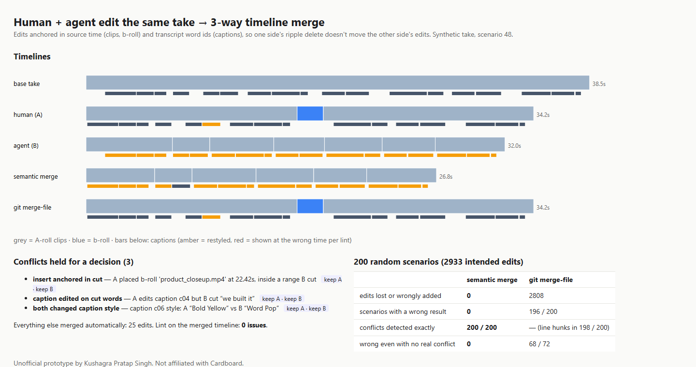

# Timeline diff + 3-way merge for human + agent video edits (prototype)

**The problem.** Cardboard's [Hard Problems](https://cardboard.ai/hard-problems) #10 is version control for video: "Git's primitives don't translate directly. Editors don't think in commits or diffs," and timeline diffs and merge conflicts "require entirely new abstractions" for "real parallel workflows". In Cardboard the agent edits the same timeline as the human: auto-cleanup "trims silent gaps and dead takes", restyles captions, adds b-roll. So parallel edits are the normal case, not just a team feature.

Merging on **timeline positions** fails. One side's ripple delete shifts everything after it, captions land on the wrong words, and one side's work silently disappears.

**What I built.** A timeline model where every edit is anchored to **source-media time**, and captions to **transcript word ids**:
- **Semantic diff:** base vs. branch → readable edits: `cut 0:06.6–0:08.9 ("we built it")`, `insert b-roll 'product_closeup.mp4' at 0:22.4`, `caption text c04 → "We built it!"`, `caption style c06 → Bold Yellow`.
- **3-way merge:** both branches' edits applied in source space. They commute unless they really collide, and only true conflicts are held back for a "keep A / keep B" decision:
  - a caption edited on words the other side cut
  - b-roll anchored inside a range the other side cut
  - both sides changed the same caption differently

  A restyle on a caption the other side deleted outright auto-resolves: the deletion wins and nothing is lost.
- **Post-merge lint** ("there's no linter for video" is Hard Problem #9), run on the exported form:
  - caption shown at the wrong time vs. its words
  - caption whose words were cut
  - cut inside a word
  - flash frames
  - duplicated source
  - timeline gaps or overlaps

## Result

**Showcase** (scenario 48, a 38 s take):
- **Human:** trims the intro, cuts a sentence, adds b-roll, fixes a caption, restyles another.
- **Agent:** 24 edits (silences, the retake, a caption restyle pass).
- **Semantic merge:** 25 edits applied automatically, **exactly the 3 real conflicts** held, **0 lint issues**.
- **`git merge-file`** on the exported timeline: 1 conflict hunk. Resolving it "ours" **drops 19 of the agent's edits** and adds 4 wrong ones.

**200 random human + agent scenarios (2,933 intended edits):**

| | semantic merge | `git merge-file` on exported timeline |
|---|---|---|
| edits lost or wrongly added | **0** | 2,808 |
| scenarios with a wrong result | **0 / 200** | 196 / 200 |
| conflicts detected exactly | **200 / 200** | n/a (line hunks in 198 / 200) |
| wrong even with **no** real conflict | **0** | 68 / 72 |



**Honest limits:**
- The take, transcript and edits come from my own generator.
- The "expected" result is computed from the edit intents. The merger only sees the two resulting timelines, so it has to recover the intents through the diff.
- Moves/reorders, multi-source timelines and FCPXML import/export aren't modelled yet.
- Git is the naive baseline that Hard Problem #10 itself names. Resolving its conflicts "theirs" instead would lose the human's work rather than the agent's.

## Run

```bash
python demo.py                                   # showcase + 200 scenarios → out/report.html (needs git on PATH)
pip install pytest && python -m pytest -q        # 6 tests incl. a 60-scenario property test
```

Standard-library Python only.

## Layout

```
tlmerge/model.py   source-anchored timeline, ops, render to timeline time (export form), rebuild from export
tlmerge/merge.py   semantic diff, 3-way merge + conflict rules, git merge-file baseline, lost-edit metric
tlmerge/lint.py    post-merge timeline lint
tlmerge/synth.py   synthetic take + random human/agent edits + expected conflicts
```

Unofficial prototype by Kushagra Pratap Singh. Not affiliated with Cardboard.
